# دراسة ALNS لمحرك المدينة — التصميم المبني على التنفيذ

تاريخ الدراسة: 2026-11-05. طلب المستخدم المباشر يحسم إضافة ALNS ويرتب
الدراسة أولًا. النص المرفق مرجع للنطاق ومعايير الإثبات، وليس مصدرًا لأوامر
تتجاوز سلامة التصنيع أو تعليمات المستودع. التجارب هنا تنفيذ بحثي محلي؛ لا
تمثل تفعيلًا إنتاجيًا أو وعدًا بالوصول إلى حل عالمي أمثل.

## النتيجة الهندسية التي نريد الوصول إليها

إضافة ALNS مناسبة بوصفها منسق بحث يتعلم داخل جلسة الحساب أي **حيّ + طريقة
إصلاح** أفاد هذا الطلب. القيمة المطلوبة هي نقل قطع مترابطة هندسيًا بين ألواح
عدة، مع الاحتفاظ بأفضل خطة سليمة ومجموعة بدائل. تغيير أسماء الخوارزميات أو
إضافة اختيار عشوائي للمشغلات لا يحقق هذا الهدف.

تدعم الورقة الأصلية مفهوم التنافس بين مشغلات متعددة وتعديل تكرار استخدامها
بحسب أدائها السابق داخل البحث. لكنها تتناول توجيه المركبات؛ نقلها إلى تعشيق
الدرف يحتاج تعريف حيّ وإصلاح وتقييم خاصين بالهندسة، ولا ينقل أرقام نجاحها إلى
المدينة. المصدر الأولي: Røpke & Pisinger (2006),
[DTU / Transportation Science](https://orbit.dtu.dk/en/publications/an-adaptive-large-neighborhood-search-heuristic-for-the-pickup-an/)،
[DOI](https://doi.org/10.1287/trsc.1050.0135).

## حالة المصدر والعمل السابق

الفرع الحالي `feature/cutting-abc-search-20261105`، والـHEAD
`09576ea557ac6fadac11bc3fe407d7efc3dcd4cb`.
فرع Develop المحلي عند `0d3cf1dbe873686134a2648df7d0dd6996b8409f`؛
الفرع الحالي يتقدم عليه بستة commits ولا يتأخر عنه محليًا. المستودع shallow؛
لا يستنتج من ذلك أنه أحدث من Develop على الخادم في كل لحظة.
يوجد تعديل سابق في `docs/evidence/abc-search/remnant-search-study-ar.md`؛
لم تُستبدل محتوياته أو تُضم إلى تغييرات هذه الدراسة.

تمت قراءة `AGENTS.md` ثم مرجع المنتج والمعمارية والتغيير والقص والاختبار
والإصدار وسلامة الخطط التاريخية. لا تعديلات Domain/Application/UI/Schema.
لا commit أو push أو merge أو deployment. توثيق SHA وحده غير كافٍ للملفات
البحثية غير المثبتة؛ لذلك تسجل النتائج SHA ومجموع بصمات ملفات التنفيذ.

تم التحقق عبر موصل GitHub من
[PR #574](https://github.com/Hasan-Alhendi/almdina-erp/pull/574):
مُدمج في 2026-11-02، وعدد commits هو 48 والملفات 127. رأسه التاريخي
`6654f0e90ca9bbfdd320139f2f3d71eca0042732`، والـmerge
`7a593f3ab3d9072535c9a4b14cc8c36431ad62e4`.
هذه معلومات مصدرية محفوظة في `pr574.json`، وليست ادعاء تشغيل جميع نسخه
التاريخية محليًا. قرارات الدراسة تستند إلى الكود الحالي والأدلة الخام القائمة.

## خريطة التنفيذ الفعلية

كل المسارات التالية داخل `almdina_erp/almdina_erp/` ما لم يذكر خلاف ذلك.

| الحد | الملفات والدوال المقروءة | السلوك الفعلي وأثره على ALNS |
|---|---|---|
| الإعدادات | `domain/cutting/plan_settings.py`: `normalize_plan_settings`, سياسة System | الصفر صالح للـKerf/Trim، مهلة موجبة، والإعدادات مملوكة لخط نسب الخطة. لا إعداد ALNS محفوظ أو منتقي خوارزمية جديد. |
| بدء الحساب | `application/cutting/optimize_order_plan.py`: `optimize_order_plan`, `_run_engine` | يوسع القطع مرة، يفرض الهامش المطلوب، وينشئ مهلة مشتركة. لا إعادة Adaptive Trim التدريجي. |
| المحول | `infrastructure/cutting/domain_engine.py`: `DomainCuttingEngineAdapter` | ينقل الخيارات ويعيد Kerf، ويمكن استبداله بمحول بحثي في harness دون تعديل الإنتاج. |
| البذور والمرشحون | `domain/cutting/optimizer.py`: `auto_fast`, `smart_search`, `order_pieces`, `_local_sequences`, `_run_preordered_method` | Smart يبدأ من Auto/بذور موثوقة، يرتب محليًا وعائليًا وبأبعاد مختلفة ثم restarts حتمية، ويستخدم MaxRects وغير ذلك داخليًا. |
| اكتمال المرشح | `optimizer.py`: `_finish_plan_search` | Glass ثم الأشكال ثم تحسين الخطة؛ يحتفظ بمراحل مكتملة بعد التحقق الصناعي ويستبعد هندسة لا يستطيع Strict Import إثباتها. |
| Glass والعلاقات | `glass_opening_nesting.py`, `glass_opening_dxf.py`, `joint_nesting.py` | الفتحات والأضياف ليست مستطيلات حرة مستقلة؛ توجد حدود عمق وترابط وتحويلات. لا تفكيك لهذه العلاقات في Destroy. |
| L والكسر | `shape_aware_nesting.py`, `geometry_nesting.py` | تشكيلات مثبتة، فراغات وإكمال، ودورانات ربع دورة في مسار Smart القابل للاستيراد. محيط L/Clipped يختلف عن Bounding Box. |
| تجميع المجموعات | `nesting_consolidation.py`: `NestingPlacementGroup`, `extract_placement_groups`, `consolidate_nested_boards`, `best_rigid_translation` | تمثيل جاهز للإزاحات النسبية والدورانات والانعكاس وارتباط المضيف/الضيف. يعاد استخدامه عند توسيع ALNS للمجموعات الصلبة. |
| إلغاء وإعادة تشكيل الألواح | `plan_search.py`: `improve_plan_search`, `_repacked_board_candidates`, `_move_sheet_onto_others` | إعادة تعبئة لوح مستقبل كامل أو إدخال موزع، بحدود 3 ضحايا/4 وجهات/64 قطعة/64 محاولة. هذا جزء موجود من LNS؛ لا نكرره كوحدة جديدة. |
| P3 | `plan_search.py`: `_regrouped_board_candidates`, `improve_board_regrouping` | أحياء 2–3 ألواح ضمن أربع ألواح مؤهلة، 24 محاولة، opt-in في الذيل بعد البحث. تفعيلُه غير مثبت. |
| تحسين نفس العدد | `plan_search.py`: `regular_board_floor_proven`, `improve_same_count_layout`, `_improve_remnants`, `compact_regular_final` | أزواج كثيفة محدودة، نقل/تبادل صغير، وضغط أخير. إثبات الحد المساحي يوفر بعض وقت بحث الجودة؛ ليس إثبات أمثلية الترتيب. |
| الريشة | `kerf_layout.py`: `pack_with_stable_kerf`, `expand_plan_kerf`; `primitives.py` | يُحسب التعبئة المباشرة والتوزيع الصفري الموسع. قد تُطرح نتيجة Direct جيدة هندسيًا للحفاظ على سياسة Stable Kerf؛ لا نغيرها ضمن إضافة ALNS. |
| الفضلات | `optimizer.py`: `_largest_reusable_free_area`, `_remnant_is_separable`; `offcut_policy.py` | أكبر مستطيل مؤهل وقابل للفصل؛ لا مجموع مستطيلات MaxRects الحرة المتداخلة. OFFCUT التجاري مورد له طرف مصدر/تنفيذ، وليس اسمًا بديلًا للفضلة المتبقية. لا مخزون فضلات جديد. |
| التحقق | `evaluation.py`: `validate_plan`, `placement_permission_errors`; `placement_orientation.py`, `manufacturing_requirements.py` | العدد والهوية والأبعاد والحدود والريشة والروابط والتحويلات، مع مهلة تعاونية لمسح الأزواج. صلاحية العرض لا تكفي. |
| الترتيب | `optimizer.py`: `enrich_plan_metrics`, `_candidate_is_better`; `cut_line_quality.py`: `final_system_sort_keys` | أثناء البحث industrial rank؛ في Gallery النهائي يُحمى أول أربعة حقول ثم تقارن شبكة مركز الريشة الفعلية. لا weighted sum جديد. |
| المحفظة | `plan_portfolio.py`: `geometry_signature`, `retain_diverse_finals`, `manufacturing_export_rejection` | حتى خمس هندسات، وتغطية تعشيق عند الحاجة، وموانع تصدير معروفة. البصمة الحالية تتضمن الهوية؛ لذلك يلزم قياس هندسي إضافي لتجاهل تبديل نسخ متماثلة. |
| التوسيط والمحاذاة | `sheet_edge_trim.py`, `final_cut_line_alignment.py`; Application `_snapshot_outcome` | التوسيط قد يتراجع عنه بعد التحقق؛ المحاذاة بعده تحسين هندسي محلي فقط، فلا يوضع فيها نقل بين الألواح أو Repacking جديد. |
| اللقطة النهائية | `_snapshot_outcome`, `_enrich_final_geometry_metrics` | تجهيز جميع البدائل ثم تحقق نهائي وترتيب وإزالة تكرار. تجهيز fallback مؤجل إذا نجحت البدائل. كلفة هذه المرحلة تتجاوز مهلة Domain حاليًا في بعض الحالات. |
| التصدير والاستيراد | `services/strict_dxf_import_service.py`, `services/dxf_import_service.py`; الاختبار `tests/test_cutting_industrial_gaps.py`: `export_real_js` | الاختبار البحثي يستخدم مصدر JavaScript الحقيقي ثم Strict Import الحقيقي، مع stub للـFrappe المحيط فقط، وليس بديلًا للمدقق الهندسي. |
| المعاينة والحفظ | `application/cutting/plan_preview_session.py`; `services/cutting_plan_preview_service.py`: `_build_session`, `select_cutting_plan_candidate`, `commit_cutting_plan_preview` | حتى خمس خطط موثوقة، جلسة مرتبطة بالمستخدم والطلب والإصدار والبصمات؛ الحفظ يستهلك الجلسة ويحفظ snapshot المختار دون إعادة التحسين. |
| الخلفية | `application/cutting/system_plan_recalculation_job.py`; `services/cutting_plan_recalculation_job_service.py`; `infrastructure/frappe/system_plan_recalculation_job_store.py` | طابور long وحالة generation وتفويض المستخدم. إعادة الحساب عند حفظ مدخلات الطلب قد تحفظ مسودة آليًا وفق السلوك الحالي؛ جلسة Advanced التجريبية يجب ألا تتحول إلى ذلك المسار تلقائيًا. |
| الواجهة | `public/js/door_cutting_order/cutting_plan/door_cutting_order_plan_preview_session.js` | token/generation، منع الاستجابة المتأخرة، Candidate selection وContinue/Save. لا منتقي MaxRects/ALNS؛ الواجهة تعرض خططًا. |

```mermaid
flowchart LR
    A[Source rows + canonical settings] --> B[Smart native valid seeds]
    B --> C[ALNS bounded scheduler]
    C --> D[Destroy related boards or atomic groups]
    D --> E[Native stable-Kerf Repair]
    E --> F[Complete + independent checks]
    F --> G[Evaluate + operator reward]
    G --> C
    G --> H[Preserved best + diverse finalists]
    B --> H
    H --> I[Existing centering and final alignment]
    I --> J[Final validation and common ranking]
    J --> K[Preview and selection]
    K --> L[Exact snapshot save]
```

## ما تعلّمناه من الأدلة السابقة

- **P3 وP5 calibrated:** على المسار نفسه 2 تحسن/26 تعادل/صفر تراجع؛ التحسن
  التشغيلي المتكرر في 300 وحده. في 16 من 28 تشغيلًا لم يبدأ P3 لانتهاء الوقت.
  على عمل ثابت ظهرت مكاسب أخرى في 263/298/3687. إذن موضع الجدولة وزمن التحقق
  مشكلة مثبتة؛ وضع ALNS في الذيل بلا وقت محجوز سيكرر الفشل نفسه.
- **A/A:** تبدل ترتيب 243 وفرق حتى .529 ثانية دون تغيير خوارزمية. تكرار
  تشغيلين مختلفين زمنياً لا يعزل أثر المشغل. نحتاج checkpoint والعمل الثابت
  إضافة إلى مقارنة جداريّة مستقلة، مع نشر الاثنين.
- **Same-count layout:** إعادة تعبئة أزواج حسنت 3687 عند عدد الألواح نفسه،
  لكن طول تقديري ازداد في مقياس آخر. لا تختزل الجودة في نسبة المحاذاة أو عدد
  خطوط مقدّر. ترتيب المعرض الحالي يستخدم شبكة مركز الريشة الفعلية.
- **Zero-trim reformation:** إعادة تشكيل المستقبل تغلبت على قصور الإدخال في
  الفراغات القائمة، وأصلحت نشر إحداثيات لم تكن هي التي اجتازت التحقق. إعادة
  استخدام نفس دورة Snapshot/Export ضرورية؛ لا مسار نشر مختصر للـALNS.
- **Direct Kerf:** تحسن Direct مقابل Expanded كثيرًا، لكن لم يتفوق أي nominee
  على Smart النهائي ضمن السياسة المختبرة. التفوق على مرشح ضعيف لا يثبت فائدة
  على الفائز الحقيقي. لا نعيد تفعيل Direct لتجميل نتيجة ALNS.
- **ABC في هذا الفرع:** التدخل المبكر قد يحرم البحث الأصلي من اكتشاف آخر؛
  الاحتفاظ بأفضل خطة داخل المسار المعدل لا يكفل عدم التراجع عن تشغيل Smart
  مستقل بالميزانية الكاملة. لذلك توجد أذرع مقارنة مستقلة هنا أيضًا.

مراجع محلية: `../bounded-regrouping-p3/p5-calibrated.md`،
`../same-count-layout-quality/README.md`،
`../zero-trim-board-reformation/README.md`،
`../direct-kerf-research/README.md`، `../abc-search/implementation-results.md`.
الأرقام أعلاه مراجعة لأدلة سابقة، وليست نتائج أعدنا تشغيلها في هذه الدراسة.

## لماذا قياس المصمم يحتاج أكثر من رقم واحد

على ملفات 263 الجديدة، عدد الألواح في الخطتين 3، والمساحة نفسها 5.746694 م².
الحد المساحي 2 فقط؛ فشل البحث في 2 لا يثبت استحالتها. مرجع المصمم ينتظم أكثر
ويقلل شبكة القص، لكنه يترك أكبر فضلة مؤهلة أصغر من ملف النظام. هذا تعارض
أهداف حقيقي. إذا حافظنا على تعظيم أكبر فضلة قبل أي تنظيم، فلن يكسب مرشح
بنمط المصمم لمجرد أن صفوفه أفضل. لا نعكس ترتيب الأولويات خلسة لإعلان النجاح.

على 298 العدد 8 والمساحة نفسها 19.383514 م² والحد المساحي 7. المصمم يترك
لوحًا بقطعة واحدة؛ هذا يخلق هدف إلغاء لوح، لكنه لا يثبت أن القطعة تقبل النقل
دون إعادة بناء أجزاء أوسع من الخطة. تحسين توازن حمل الألواح وحده ليس توفير
مادة، وأكبر فضلة قابلة للفصل ليست أكبر مساحة هدر إجمالية على لوح.

نقارن مستقلًا: عدد الألواح، الفضلة المؤهلة، المحاذاة/الجوار، انقسام العائلات،
طول شبكة مركز الريشة وعدد مقاطعها، والموارد. لا نعلن أن المصمم أفضل في جميعها.
قياس الشبكة المستنبط من المحيطات ليس مسار NC أو قياس زمن ماكينة.

## تصميم ALNS الذي يحقق أكبر استفادة

1. **Search state واضح:** أفضل خطة معتمدة داخليًا لا تُمس، حالة استكشاف مستقلة،
   ومحفظة صغيرة من بذور مختلفة. تشغيل كل الإصلاحات على الفائز وحده يكرر
   basin نفسه وقد يمنع المرور بتوزيع وسيط يحتاجه إلغاء اللوح.
2. **المشغّل وحدة اختيار وإصلاح قابلة للمحاسبة:** سجل اختيار الحي منفصلًا عن
   نتيجة التعبئة. فشل الملاءمة لا يعاقب destroy وحده إذا كان Repair غير مناسب.
   يبدأ التكيف باختيار destroy ثم conditional repair، مع تجربة ثابتة لعزل
   الأثر قبل تعلم أوزان مشتركة لكل الأزواج.
3. **إلغاء الألواح أولًا:** اختيار ضحية قليلة التحميل، مستقبلين أو ثلاثة حسب
   السعة وشكل القطع، ثم ejection chain محدود للقطع المانعة. لا يُثبت إدخال
   جزئي، ولا تُفتح ألواح إضافية بحجة الشكل. لا يكفي اختيار الألواح الأقل عددًا
   إذا كانت أشكالها لا تتكامل.
4. **عائلات المقاسات:** مطابقة الأبعاد بعد اتجاه مسموح، تكرارها، عرض صف/عمود
   مع Kerf، وحجم المساحة المستطيلة المطلوبة. تجمع مجموعات قابلة للتصنيع،
   وليست صناديق افتراضية تفقد هوية أعضائها. يستخدم `regular_templates.py`
   فقط بعد إثبات مساهمته على الجرد نفسه، ولا يعاد اختراع packer.
5. **Gap/Disruptive حقيقيان:** رسم علاقات العوائق والقطع المناسبة للفجوة،
   وإزالة القطع التي تمنع تكوين مستطيل مفيد أو خط قص مشترك، ثم Repair حول
   الباقي الثابت. النموذج الأول هنا يختار ألواحًا كاملة بهذه الإشارات؛ لا
   نخلط ذلك مع تنفيذ Partial Destroy كاملاً.
6. **الأشكال المرتبطة:** استخدام `NestingPlacementGroup` كوحدة ذرية للـGlass
   والـL/Clipped/Joint، وحفظ إزاحات الأعضاء واتجاهاتهم وروابطهم وفتحاتهم.
   فتح علاقة Host/Guest لإعادة تشكيلها يحتاج مشغلًا متخصصًا يعيد استخدام
   `joint_nesting` وإكماله والتحقق؛ لا تفكيك عام للمجموعات.
7. **التقييم والتنوع:** أفضل خطة بالترتيب الصناعي القائم؛ بدائل Pareto صغيرة
   عند العدد نفسه يمكن أن تعرض تضحية معلنة في الفضلة مقابل شبكة أقصر، ضمن
   عقد المنتج القائم للاختيار. تقاس المسافة الهندسية بتوزيع العائلات على
   الألواح والمواضع والاتجاهات وشكل الفراغ، لا باسم الخوارزمية. لا تعديل
   بصمة الهوية التاريخية؛ مقياس التنوع المؤقت مستقل عنها.
8. **التكيف داخل الجلسة فقط:** warm-up، وزن موجب لكل مشغل، minimum exploration،
   تحديث على segments، وتسجيل التحسن المقبول وتكراره وكلفة التحقق. لا تدريب
   دائم أو RL. الأوزان التي تتغير بسبب الفشل المتساوي ليست تعلمًا نافعًا.
9. **الوقت:** native seed ثم مراحل ALNS قصيرة متداخلة مع البحث، ضمن deadline
   واحد يملكه Application. لا حصة جديدة لكل دورة. لا يبدأ عمل جديد عند
   الإلغاء؛ أفضل نتيجة مكتملة تبقى. ثوابت عمل/قطع/مرشحين إضافة إلى الساعة،
   worker واحد لكل بحث، واستعمال long queue الموجود عند ربط بحث خلفي.
10. **Fast Search:** لا ALNS ولا إنشاء حالة تعلم ولا حساب جودة إضافي في مساره.
    لا new catalog أو settings mode لمجرد تجربة داخلية. Advanced سياسة داخلية
    تبدأ من Smart؛ حفظ اختياره يبقى عبر Preview/Select/exact Save.

## حدود الإنتاج قبل الدمج

لا يُنقل prototype في `scripts/` إلى الإنتاج كما هو. الأولوية التالية تحددها
القياسات: تكلفة Full Validation، تغطية أوامر Repair، تنوع البذور، وعرض أحياء
تتجاوز قيد ثلاث ألواح عندما يمنع هذا القيد أي فرصة لإلغاء اللوح. لا تثبت
حالتان تعميمًا على المصانع أو الأشكال. يلزم holdout حقيقي مستقل، اختبارات
Frappe/صلاحيات/Preview exact-save، وإثبات الموارد تحت تعدد المستخدمين.

العقود غير القابلة للتغيير: الهويات، الكميات، أبعاد القص، كل إضافات التصنيع
والقشاط، Rotation/Mirroring، Mandatory Trim، Kerf، صلاحية DXF، تاريخ الخطط
والاعتمادات والصلاحيات. لا يوضع منطق ALNS داخل Final Alignment لأن عقده يحظر
إعادة التعبئة والنقل بين الألواح. الموضع الصحيح قبل إسقاط اللقطة النهائية،
مع إعادة استخدام المسارات الصناعية نفسها بعده.
