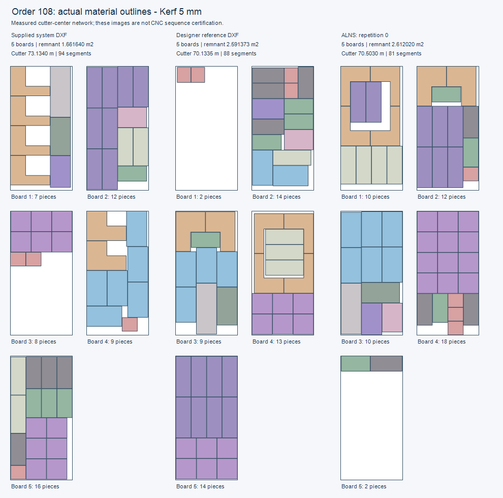
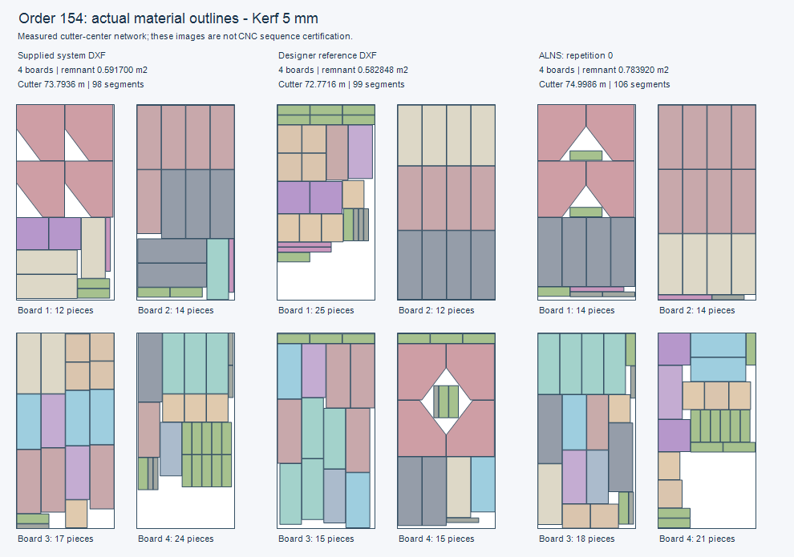

# ALNS من زر إعادة الحساب — دراسة ونتائج قابلة للمراجعة

تاريخ القياس: 2026-11-06. إصدار المحرك: `2.2.0-alns-refinement`.
الفرع: `feature/cutting-abc-search-20261105`، وأساس العمل قبل هذه الإضافة
هو `26cbbfce1e7e14704c67a5645ad509d21464c4eb`.

أصبحت مرحلة ALNS موصولة بمسار System الحالي الذي يستخدمه زر **إعادة الحساب**.
تحسنت أكبر فضلة مستطيلة قابلة لإعادة الاستخدام في 108 و154 عن مرجع المصمم،
مع نفس عدد الألواح والقطع. **لم يتحقق التفوق على المصمم في جميع المقاييس**:
طول شبكة القص أطول في الطلبين، وعدد مقاطعها أكبر في 154. الهدف الحالي يرتب
عدد الألواح أولًا، ثم الفضلة، ثم جودة مسارات القص وفق المقارن النهائي الموجود.
هذه مقايضة معلنة وليست إثبات أمثلية أو اعتماد تشغيل CNC.

## كيف تختبر من الواجهة

1. حدّث بيئة الاختبار إلى آخر commit على الفرع أعلاه، وأعد تشغيل عمليات Python
   للويب والعامل الذي ينفذ إعادة الحساب. لا تتطلب هذه الإضافة حقولًا أو migrations
   أو زرًا جديدًا؛ لم تُنشر إلى موقع حي من هذه الجلسة.
2. افتح الطلب ثم خطة **النظام / System**. اضبط الريشة على 5 مم والهامش الفعلي
   المطلوب؛ القياسات المنشورة هنا تستخدم هامشًا صفرًا. فعّل دوران جميع الدرف.
   يظل حقل **قابل للانعكاس** في الطلب هو السلطة: نعم يسمح، ولا يمنع. القياسان
   108 و154 هنا يستخدمان نعم بحسب توجيه المستخدم.
3. استخدم Smart وCNC Router أو Auto، ثم زر **إعادة الحساب** المعتاد. لا يوجد
   اختيار مستقل باسم ALNS. Fast وPanel Saw يبقيان على مسارهما المناسب دون هذه
   المرحلة. إذا كانت مهلة البحث الأصلية 10 ثوانٍ، تحصل ALNS على حتى 10 ثوانٍ
   إضافية؛ ليست هذه مهلة استجابة صلبة. القياس الكلي هنا نحو 22–23.2 ثانية
   للطلبين الجديدين، ويختلف مع الجهاز والبيانات والتحقق والمحاذاة.
4. راجع البدائل في المعاينة، وافحص أكبر فضلة ومسارات القص، ثم اختر واحفظ بالطريقة
   الحالية. يبقى الحفظ ملتزمًا بالمرشح المعروض دون إعادة توزيع خفية عند الحفظ.

الربط الفعلي في `calculate_system_plan`؛ اختبار الرحلة يمر من نقطة التركيب
هذه إلى Application وDomain الحقيقيين مع عزل IO الخاص بـFrappe. اختبار الموقع
الحي نفسه لم يُنفّذ، ولا تكفي صورة الخطة أو صحة DXF وحدهما لاعتماد برنامج ماكينة.

## مقارنة المصمم

ألواح 1220 × 2440 مم، ريشة 5 مم، دوران جميع القطع، انعكاس مسموح في الدراسة،
وحدود تأهيل الفضلة الافتراضية 30 سم × 30 سم و0.09 م². الأرقام تقيس **أكبر
مستطيل قابل لإعادة الاستخدام**، ولا تعني مجموع الفراغات أو وجود قطعة مخزون جديدة.

| الطلب | ألواح / قطع | فضلة المصمم م² | فضلة ALNS م² | الزيادة | شبكة المصمم م | شبكة ALNS م | المقاطع: المصمم ← ALNS |
| --- | --- | --- | --- | --- | --- | --- | --- |
| 108 | 5 / 52 | 2.591373 | 2.612020 | 0.80% | 70.133531 | 70.503000 | 88 ← 81 |
| 154 | 4 / 67 | 0.582848 | 0.783920 | 34.50% | 72.771578 | 74.998578 | 99 ← 106 |

تتطابق كميات ومقاسات الصناديق المحيطة في 108، لكن أعماق قصات L في المصدرين
تختلف 1 مم؛ **لا يتطابق جرد الأشكال حرفيًا**. كما أن مرجع المصمم يتضمن إزاحة
داخلية بينما تسمح التجربة بهامش صفر؛ لا تنسب مكسب 108 كله إلى الخوارزمية وحدها.
في 154 يتطابق جرد الأشكال بعد السماح بالانعكاس. طول الشبكة يزيد 0.369469 م
في 108 و2.227 م في 154. هذه أطوال مركز الأداة المحسوبة، وليست زمن تشغيل أو
تسلسل NC أو عدد مرات رفع الأداة. كما زاد تشتت بعض عائلات المقاسات، وتظهر
الأرقام في CSV؛ لا ندعي أن التنظيم تحسن في كل تعريف ممكن له.

الرسوم تعرض حدود المادة الفعلية، والألوان تجمع المقاسات للمقارنة، ولا تمثل
ترتيب حركة ماكينة:





نسخ متجهية للتكبير: [108](report/comparison-108.svg)، [154](report/comparison-154.svg).

## هل التحسن مجرد زيادة وقت البحث؟

شُغلت الحالات الأربع بالتتابع في عمليات مستقلة، مرتين لكل ذراع، مع عكس ترتيب
الأذرع في التكرار الثاني. Native يأخذ 10 ثوانٍ، ALNS يأخذ Native 10 + حتى 10
إضافية، والضابط الثالث Native يأخذ 20 ثانية دون ALNS. لم تعمل تجارب متوازية
أثناء هذه المصفوفة النهائية. النتائج الهندسية أدناه تكررت في التشغيلين:

| الطلب | الألواح | فضلة Native 10 م² | فضلة ALNS 10+10 م² | فضلة Native 20 م² | طول الشبكة: Native 10 / ALNS / Native 20 م |
| --- | --- | --- | --- | --- | --- |
| 108 | 5 | 1.623820 | 2.612020 | 1.623820 | 71.644500 / 70.503000 / 71.644500 |
| 154 | 4 | 0.354530 | 0.783920 | 0.438285 | 74.554544 / 74.998578 / 73.543544 |
| 263 | 3 | 2.686440 | 2.686440 | 2.686440 | 46.191000 / 46.191000 / 46.055000 |
| 298 | 8 | 1.688480 | 1.710440 | 1.688480 | 113.803000 / 112.423500 / 113.803000 |

ALNS أفضل وفق المقارن النهائي في 108 و154 و298 مقابل الضابطين، وتعادل Native
10 في 263، لكنها **أسوأ من Native 20 في 263**: نفس الفضلة ومسار أطول 136 مم
و74 مقطعًا بدل 69. إبقاء نتيجة Native الأصلية يمنع التراجع عنها في الجلسة
ذاتها؛ لا يضمن التغلب على بحث مستقل أطول أو على جميع البذور والميزانيات.
لا تخلط نتيجة 298 هنا مع نقاط أبحاث سابقة استعملت ميزانيات أطول أو استمرارًا
من بذور محفوظة.

المدخلات أعيد بناؤها من هندسة ملفات النظام بهويات اصطناعية؛ لا تحتوي كل حقول
الطلب الحي أو إضافاته أو إعداداته التشغيلية، ولذلك ليست وعدًا بتطابق أرقام
الموقع حرفيًا. ملف النظام المرفق وNative المعاد حسابه ليسا نفس تشغيل المحرك.
الأربع حالات استُخدمت للدراسة والضبط؛ لا تمثل مجموعة مستقلة لإثبات التعميم.

## ما الذي أضيف ولماذا؟

تثبيت جميع الزوايا منع الإصلاح المستطيل وحده من الوصول إلى فضلات المصمم.
أضيفت عملية مركبة تعيد تكوين مجموعات الزوايا وضيوفها القانونيين، ثم توزع
عائلات الدرف المتكررة وتصلح باقي الخطة بوظائف التعشيق الأصلية. يمكن للحالة
الداخلية أن تتراجع مؤقتًا؛ لا يدخل المعرض إلا مخطط مكتمل متحقق يتفوق على
النتيجة الأصلية النهائية. يتكيف اختيار مشغلات الإصلاح العادية مع نجاحها
داخل الجلسة، دون تعلم دائم أو قراءة توزيع المصمم.

هناك حدود للمحاولات والقطع والمهلة؛ الأشكال الخاصة والإضافات والمجموعات
المحمية لا تُفكك عشوائيًا. صلاحيات الدوران والانعكاس والريشة والهامش والتحقق
الكامل تبقى إلزامية. تحريك مجموعة زاوية كاملة يحدث كاقتراح بحث مستقل قبل
الإسقاط؛ عقد Final Alignment القائم لم يُوسع ليحرك أجزاء الأشكال.
تفاصيل التجارب والحدود وأسباب تعديل الفرضية في [البروتوكول](protocol-ar.md).

حُفظت التجارب الاستكشافية والنتائج السلبية بدل انتقاء تشغيل موفق. تختلف
نسخ الكود والمهل بين مجلدات المحاولات الأولية، وبعضها تزامن مع اختبارات قصيرة؛
لا تُعامل كقياس نهائي مضبوط. تجربة `contact-boundary-application` الأخيرة لم
تحسن الهدف المقاس، فاستُبعدت من كود المنتج؛ نسخة الكود التجريبي محفوظة في
`pilot-source-contact-boundary`. النسخة المقاسة والمعتمدة هنا هي فقط
`final-matrix` المرتبطة ببصمات المصدر المجمدة.

## أدلة التحقق وإعادة القياس

- [نتيجة JSON المجمعة](report/summary.json) و[جدول جميع المشاهدات](report/observations.csv):
  24/24 مخططًا صالحًا، و120/120 دورة تصدير JS الفعلي ثم Strict Import للبدائل،
  و4–5 توزيعات مادية متميزة في المعرض (قد تختلف بيانات مرشحين لهما نفس التوزيع).
- [نتائج pytest النهائية](final-regression.xml): 267 اختبارًا و123 حالة فرعية؛
  صفر إخفاقات وأخطاء وتخطي. نجحت أيضًا محاكاة JavaScript الأربع للمعرض
  وملكية المعاينة وقفل مرحلة الحفظ واللغة.
- [فحص مسافات الملفات المرجعية](reference-clearance.json): لا تداخلات ولا
  مسافة أقل من 4.95 مم، وأقل مسافة قريبة من 5 مم ضمن الدقة العددية.
- [مدخلات 108](input-108.json) و[154](input-154.json): وصف الأشكال والمقارنة
  وبصمات DXF الأصلية. CUT_PATH في مرجع المصمم يعامل كحدود مادة بطلب المستخدم؛
  طبقة 0 في 154 نسخ مزاحة للقطع وليست 67 درفة إضافية. لم يعدل أي ملف أصلي.
- [بصمات المصدر المجمد](frozen-source-manifest.json)، و`source-snapshot/`:
  71 ملفًا مطابقًا بايتًا لما قاسه كل عامل في المصفوفة. قد يطبع Git نهايات
  أسطر ملفات المنتج عند checkout؛ اللقطات الخام محفوظة لتدقيق القياس نفسه.
- `final-matrix/index.json` يربط كل سجل كامل ببصمته. يتضمن كل سجل البيئة
  وذاكرة العملية والبدائل والهندسة والتحقق والبذور وإعدادات المقارنة؛ الذاكرة
  المسجلة للعملية نحو 58.4–61.3 MiB، وليست قياس ذاكرة خادم Frappe كاملًا.

من جذر المستودع في بيئة الاختبار، استخدم مجلد إخراج جديدًا غير موجود مسبقًا:

```powershell
.venv/Scripts/python.exe scripts/benchmark_alns_ui.py --matrix --cases 108 154 263 298 --budget 10 --repeats 2 --strict --output .pytest_cache/alns-ui-replay
.venv/Scripts/python.exe scripts/summarize_alns_ui.py --help
```

أداة التلخيص النهائية تتحقق من بصمات المصفوفة والمدخلات والمصدر المجمد قبل
استخراج النتائج. لا تحول اختلاف نسخة الكود أو بيئة التشغيل إلى تطابق مضمون.
المحاكاة مع Frappe المعزول والتحقق المحلي لا تحلان محل تجربة الواجهة على
بيئة الاختبار أو مراجعة المصنع لترتيب التشغيل الفعلي. يبقى تحسين طول المسار
والتشتت بعد تثبيت أكبر فضلة مجال العمل التالي؛ نتائج هذا الإصدار لا تثبت
التفوق الشامل على المصمم.
