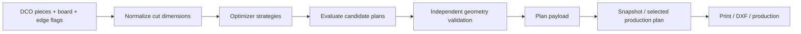

# 05 — القص والرسم وDXF

> **Status:** Canonical  
> **Audience:** مدخل البيانات، عامل الرسم/CNC، developers, QA

## 1. هدف هذه المنطقة

مدخل البيانات يحتاج رسمًا توضيحيًا سريعًا للدرفة الخاصة، بينما التخطيط/التصنيع يحتاج Geometry دقيقة قابلة للتحقق. لذلك يجب الفصل بين **سهولة الإدخال** و**صحة بيانات الإنتاج** دون جعل المستخدم العادي يعمل كمهندس CAD.

## 2. وحدات القياس

- إدخال قياسات القطع في واجهة الطلب يكون بالمقاييس التجارية المعتمدة في DCO (عادة cm في حقول القطع الحالية).
- DXF والإحداثيات الهندسية التشغيلية تستخدم **mm**.
- التحويل بين الوحدات يجب أن يكون في طبقة واحدة معروفة، لا في عدة UI functions مستقلة.

## 3. Cutting pipeline



المحرك يعيش أساسًا تحت:

- `domain/cutting/`
- `application/cutting/`
- Adapters في `infrastructure/cutting/` و`infrastructure/frappe/orders/`.

نتائج تعشيق L والكسر وGlass والبحث مرشحون داخليون؛ يجوز تجربة مرشح يستهلك ألواحًا أكثر لمواصلة البحث. الاختيار النهائي يقارن Baseline ونتائج المراحل عبر `industrial_rank`، بعد التحقق المستقل من الاكتمال والهندسة وKerf وصلاحيات الاتجاه. لا يجوز زيادة عدد الألواح مقابل تكوين Quad أو زيادة ضيوف الفتحات. عند تساوي عدد الألواح تُطبّق مقاييس الفضلة القابلة للفصل والتعقيد الحالية؛ ولا تُحسب فتحات L وGlass كفضلات جاهزة. تُحفظ بيانات وDiagnostics المرشح المختار فقط. إذا لم توجد خطة مكتملة صحيحة، تبقى نتيجة فشل Baseline لمسار Adaptive Trim ورسائل التحقق، ولا تُعتمد كخطة تصنيع صحيحة.

بعد اكتمال التعبئة تُعكس إحداثيات Y داخل المساحة القابلة للاستخدام حتى تتجمع الدرفات أسفل اللوح وتبقى الفضلة أعلاه، ويُعكس ترتيب الألواح بحيث يظهر آخر لوح فُتح أولاً في المعاينة والطباعة وDXF. خطط DXF المرفوعة لا تُعاد توجيهها.

## 4. القشاط ومقاسات القص

القشاط ليس مجرد رسم بصري. اختيار القشاط/سماكته يؤثر على **Cut dimensions** حسب قواعد Domain. لذلك:

- UI يجمع side flags/type.
- Domain يحسب أبعاد القص.
- Plan/DXF/printing يجب أن تستهلك نفس النتيجة، لا تعيد حسابها بصيغ مختلفة.

عند تغيير قاعدة سماكة القشاط، اختبر Order entry + optimizer + print + DXF معًا.

## 5. Special shapes

هناك قطع Regular، clipped-corner (قطر)، L-shaped corner (زاوية قائمة)، وSpecial/custom geometry. قواعد الصلاحية/الهندسة يجب أن تبقى Server-side. الزاوية المقصوصة وزاوية L نوعان parametric مستقلان يشتركان في الحقول الثلاثة `clipped_corner_position` / `clipped_corner_width_cm` / `clipped_corner_length_cm` وفي مسار التحقق والتسعير والخطة/DXF؛ الفرق الوحيد هو مضلع القص: خمسة رؤوس بوتر قطري مقابل ستة رؤوس بضلعين متعامدين. الحقلان المخزّنان يبقيان **مسافة القص من الزاوية** على ضلعي العرض والطول، بينما واجهة الإدخال تعرض/تحفظ عبر **طول الجزء المتبقي من كل ضلع** (`المتبقي = طول الضلع − مسافة القص`). عند تعديل العرض/الطول الخارجي بعد إدخال المتبقي، تُعاد كتابة مسافات القص المخزّنة للحفاظ على أطوال المتبقي السابقة (مع قصّ المتبقي فقط إذا أصبح المقاس الخارجي أصغر من أن يستوعبه). واجهة «توثيق الدرفة الخاصة» تجمع صورة العميل والملاحظات والقياسات فقط، ولا تنتج geometry للتصنيع. أي `special_shape_geometry_json` أو DXF دقيق يأتي من مسار المصمم/التصنيع المستقل ويخضع للـvalidation حتى لو بدا الشكل صحيحًا في Canvas.

عند استيراد DXF، قطعة `Special` تعني **محيطًا خارجيًا غير مستطيل داخل مقاس التصنيع المحفوظ**. المستطيل المحاور درفة `Regular` ولا يُطابق درفة خاصة حتى لو تساوت الأبعاد. رسم الطلب تقريبي ولا يُقارن برؤوس DXF أو بتفاصيل الأضلاع. يجوز أن يكون المحيط دائرة أو متوازي أضلاع أو شكلًا مقعرًا أو أي مضلع مغلق صالح بعد تسطيح القارئ الحالي لـ ARC وCIRCLE وSPLINE. مرجع التصنيع هو `cut_width_cm × cut_length_cm` المحفوظان في الطلب. بسبب أن جدول القياسات لا يسجل جهات القشاط الأربع لقطعة Special، يجوز أن يكون `Bounding Box` الفعلي مساويًا للمقاس المحفوظ أو أصغر منه حتى 2 مم في العرض وحتى 2 مم في الطول، كل محور على حدة. هذا حسم أحادي الاتجاه: لا يسمح بأي زيادة، ولو 0.01 مم، ولا يسمح بالنقصان بأكثر من 2 مم في أي محور. يطبق الشرط نفسه بعد التدوير فقط عندما يكون `allow_rotation` مفعّلًا؛ وإلا يرفض الاتجاه المدور. تبقى أبعاد القص المحفوظة في الطلب كما هي، وتبقى Geometry DXF الفعلية مرجع الشكل والموضع في الخطة والطباعة. تبقى الفتحات الداخلية مملوكة لمحيط خارجي واحد، وإذا لم تستطع أدلة الطلب والبنية الهندسية التمييز يقينًا بين فتحة وقطعة مستقلة يفشل الاستيراد صراحة بدل التخمين. علامات تصنيع الإضافات (اللاينر وفرزة الظهر ومسكة الغطس) تُرسم على طبقات مستقلة `Liner` و`Rear Groove` و`Handle Recess` فوق أي درفة من الأنواع الأربعة، ولا تُعد قطع قص ولا توضع على `CUT_PATH`. للدرفة العادية والزوايا والزجاج يبقى التحقق التفصيلي للضلع والإزاحة والعرض. للدرفة الخاصة يكفي وجود المسار على الطبقة الصحيحة وارتباطه بدرفة خاصة واحدة وسلامة المسار ومطابقة تركيبة الإضافات، دون ضلع أو بعد عن الحافة، مع إعادة استخدام هامش الامتداد ومركز الريشة الموجودين لنوع المسار؛ والدرفات الخاصة المتكافئة بالأبعاد تُطابق كمجموعة حسب التركيبة لا حسب ترتيب الصفوف. خطة النظام لا تخترع مسار تشغيل لإضافة خاصة لم يُستورد مسارها. الخانة المفعّلة لفرزة الظهر ومسكة الغطس تتطلب علامة واحدة مطابقة على الطبقة داخل تلك الدرفة. اللاينر يُخزَّن كقائمة إعدادات بعرض مشترك للدرفة في الأنواع التي تحدد موقعًا، وتُدمج مناطق التفريز المتقاطعة هندسياً قبل توليد مسارات مركز الريشة على طبقة `Liner`، لذلك لا يُشترط أن يساوي عدد كيانات الطبقة عدد اللاينرات في الطلب وتُطابق الهندسة المتوقعة ضمن سماحية المشروع. العلامة المرسومة دون تفعيل الخانة تُرفض. العلامة قد تكون خطًا أو مسارًا مفتوحًا أو مضلعًا مغلقًا؛ المطلوب أن تقع كل نقاطها داخل درفة واحدة بعد مطابقة الطلب. طباعة خطة القص تُبقي علامات الإضافات في مواضعها الهندسية: فرزة الظهر كخط متقطع أخضر أنحف، واللاينر كخط متقطع واحد أزرق بنفس الأسلوب، ومسكة الغطس كمستطيل بخطوط رفيعة في حدود العلامة، وتضيف رمزي دبل القشاط ودبل كامل الدرفة من خانات الطلب (بلا مسار DXF)، مع دليل رموز لكل الإضافات الخمس في رأس كل صفحة ألواح جاهزة للطباعة.

الصورة المرجعية في واجهة التوثيق تدعم اقتصاصًا غير تدميري: يبقى الملف الخاص الأصلي محفوظًا كما هو، بينما تُحفظ حدود الاقتصاص النسبية وأبعاد الصورة داخل عقد التوثيق. الاقتصاص اليدوي هو المرجع النهائي، ويمكن للاقتصاص التلقائي اقتراح إزالة الهوامش البيضاء فقط؛ يجب أن يبقى الاقتراح قابلًا للتعديل قبل تطبيقه حتى لا تضيع خطوط الرسم الخفيفة. الطباعة تستهلك نفس حدود الاقتصاص، ولا يحول ذلك الصورة أو الرسم إلى Geometry تصنيع.

## 6. System plan وCustom/Uploaded plan

النظام قد يحتفظ بأكثر من مصدر لخطة القص لأغراض المقارنة والعمل:

- System-generated plan.
- Custom/uploaded DXF-derived plan.
- Approved production plan.

المستخدم يحتاج Capabilities مختلفة للعرض/إعادة الحساب/الرفع/الاعتماد. اعتماد الخطة هو نقطة تثبيت لما سيغادر مرحلة التخطيط إلى الإنتاج، ويثبّت هندسة القص دون أن يشترط سعر اللوح أو أجور القص أو اعتماد أسعار الدرف الخاصة؛ تلك تبقى على تبويب التكلفة والمستندات المالية. تبويب **الخطة المعتمدة** يعكس علاقة `Door Cutting Order.approved_plan` الحالية فقط؛ فتح التاب لا يعتمد خطة، ولا تُعرض خطة Approved يتيمة أو تابعة لطلب آخر كاعتماد لهذا الطلب. تبويب **الخطة المرفوعة** يبقي آخر خطة DXF مرفوعة ظاهرة حتى بعد اعتمادها أو إلغاء ذلك الاعتماد؛ مسودة رفع أحدث تحل محلها عند وجودها. أثناء جلسة تعديل إعدادات خطة النظام تبقى تبويبات **الخطة المرفوعة** و**الخطة المعتمدة** معطّلة حتى الحفظ أو الإلغاء، حتى لو أُعيد رسم مساحة العمل؛ القفل جزء من رسم شريط المصدر نفسه وليس خطوة لاحقة قابلة للسباق.

حفظ صريح لأي مدخل يؤثر على توزيع القطع (قياسات الدرف، الكمية، النوع، أضلاع/سماكة القشاط، مقاس اللوح، الدوران، الأشكال الخاصة) يبقي طلب الحفظ سريعًا: يثبّت الصفوف ويعلّم مسودة خطة النظام بأنها قديمة، ويلغي اعتماد خطة الإنتاج الحالية إذا لم تعد مطابقة، دون تحويل هندستها إلى مسودة. اسم الزبون ونوع اللوح ولون القشاط لا تدخل هذا العقد. قبل ذلك الحفظ تُنسخ قيم الخلايا المفتوحة في جدول القياسات إلى النموذج حتى لا تُفقد إذا بقي المؤشر داخل الخلية، ويُقفل وضع التعديل من نفس النقرة حتى لو تأخر `after_save` في Frappe. إذا كان المستخدم يملك `recalculate_plan` والحالة تسمح بإعادة الحساب، يُجدول حساب خطة النظام في طابور `long` ثم تُحفظ الخطة وتكلفة الألواح/القص تلقائيًا عند اكتمال العامل. الواجهة لا تُجمَّد. Checkpoint الداخلي قبل زر إعادة الحساب/المعاينة لا يطلق هذا المسار. خطة DXF المرفوعة لا يُعيد المحسّن توليدَها؛ تُعلَّم فقط بأنها قديمة ويظهر فوق رسمها بانر واضح أن الخطة غير مطابقة للطلب لأن بيانات القص تغيّرت. زر إعادة الحساب اليدوي يبقى لمسار الإعدادات والمعاينة وإعادة المحاولة إذا تعثر العامل الخلفي.

تنزيل DXF للخطة الحالية يسأل `get_validated_dxf_plan` في كل مرة؛ قرار
`prefer_original_upload` يحدد تنزيل الملف الأصلي كما هو أو توليده عبر `buildDxf`،
و`include_saw_centers` يحدد إضافة مسارات التصنيع. أعلام مساحة العمل المخزنة ليست
مرجع قرار التنزيل. طلب الأرشيف التاريخي، وتبويب الخطة المرفوعة بعد التسليم، يبقيان
تنزيلًا للأصل عبر فحص صلاحية الطلب وارتباط الملف بالخطة على الخادم؛ لا يحاولان
إعادة توليد ملف تصنيع من خطة تاريخية. تبويب الخطة المعتمدة يبقى مسار تصنيع.

## 7. Canonical Plan Settings

إعدادات خطة القص لها عقد Domain واحد تحت `domain/cutting/plan_settings.py`. القيم الأساسية هي:

- `optimization_mode`
- `machine_type`
- `optimization_time_limit_sec`
- `kerf_mm`
- `preferred_trim_mm`

القواعد:

- `kerf_mm >= 0`، والقيمة `0` قيمة صحيحة وتبقى `0` حتى محرك القص.
- زيادة Kerf توسّع الفجوة بين الدرف مع الإبقاء على ترتيب وتدوير توزيع الهامش الصفري لنفس الخوارزمية ونفس ترتيب الإدخال، ما دام هذا التوزيع لا يزيد عدد الألواح ولا يترك قطعة بلا مكان. إذا لم يعد ممكنًا، تُستخدم نتيجة التعبئة المباشرة بذلك الهامش.
- `preferred_trim_mm >= 0`، والقيمة `0` قيمة صحيحة وتعني عدم تطبيق هامش التشذيب المفضل.
- `optimization_time_limit_sec` يجب أن يكون رقمًا finite وأكبر من `0`.
- لا يجوز استخدام falsy fallback من نوع `value or default` لاستبدال صفر صحيح بقيمة افتراضية.
- Factory Production Settings هي **defaults لأول Cutting Plan بلا lineage فقط**. بعد وجود Plan تصبح إعداداتها وإعدادات revisions اللاحقة مملوكة للـPlan lineage ولا تتغير عند تعديل defaults المصنع.
- Preview والحساب النهائي يستهلكان نفس `PlanSettings` validated contract؛ لا يملك أي منهما قواعد normalization مستقلة.
- Frappe metadata ليست سلطة Business Validation. حقل التخزين التاريخي `trim_margin_mm` يمثل `preferred_trim_mm` عند حدود Frappe فقط ولا يغيّر معنى العقد في Domain.

## 8. Adaptive Trim

Adaptive Trim هو Business Rule صريح تحت `domain/cutting/adaptive_trim.py`، وليس Strategy قص مستقلة ولا سلوكًا مخفيًا داخل optimizer.

- **Preferred Trim** هو `preferred_trim_mm` القادم من `PlanSettings` والمملوك لـCutting Plan lineage.
- **Applied Trim** هو الهامش الفعلي الذي استُخدم في الخطة المحسوبة بعد تطبيق Adaptive Trim.
- يبدأ القرار دائمًا بالـPreferred Trim كاملًا على محوري العرض والطول.
- لا يُخفّض الهامش إلا إذا كان ذلك يحسن feasibility أو يمنع لوحًا إضافيًا غير ضروري.
- عند الحاجة إلى relaxation، يُخفّض محور العرض أو الطول فقط إذا كان هذا المحور هو الذي يحتاجه الحل؛ لا يُخفّض المحوران معًا إلا إذا تطلبت الهندسة ذلك.
- يحتفظ القرار بأكبر Applied Trim ممكن بدقة `0.1 mm` بدل القفز مباشرة إلى الصفر.
- ترتيب القرار deterministic: width-only ثم length-only ثم both، وبعدها refinement للمحاور التي ثبت أنها تحتاج relaxation.
- كل probe/refinement/final evaluation يستخدم **نفس `optimization_mode` الذي اختاره المستخدم** ونفس machine/time-limit/options. Adaptive Trim لا يبدّل الخوارزمية سرًا إلى `Auto` أو غيرها.
- `kerf_mm` لا يُخفّض ولا يُعدّل مطلقًا بواسطة Adaptive Trim؛ كل evaluations تستخدم Kerf نفسها.
- أبعاد اللوح الفيزيائية `full_*` لا تتغير. الذي يتغير فقط هو `usable_*` الناتج عن Applied Trim.
- عند غياب Applied Trim الصريح، فرق أبعاد اللوح المحفوظة `full − usable` يثبت الهامش لكل محور، بما فيه الصفر عند تساوي البعدين؛ لا يُستبدل هذا الصفر بالهامش المفضّل العام. أبعاد usable الأكبر من full متعارضة ولا تسمح بتصدير التصنيع. التحقق وإعادة بناء snapshot التصدير يستخدمان التفسير نفسه دون إعادة كتابة الخطة المحفوظة.
- نتيجة القرار تُحفظ داخل Plan snapshot في `trim_policy` مع Preferred Trim، Applied width/length trim، المحاور المخفّضة، precision، وجودة الخطة قبل/بعد. وتبقى مفاتيح `applied_trim_*` و`margin_policy` القديمة للتوافق مع القراء الحاليين.
- أي validation أو DXF path يعتمد حدود المساحة القابلة للاستخدام يجب أن يستهلك **Applied Trim / usable dimensions** من نتيجة الخطة، وألا يعيد فرض Preferred Trim بعد الحساب.
- معاينة خطة القص والطباعة ترسمان اللوح الفيزيائي الكامل، وتُبعد الدرف بمقدار Applied Trim عن حواف اللوح دون تلوين أو خطوط إضافية للهامش. قرار Adaptive Trim لا يتغير: الإزاحة تتبع الهامش المطبق فعليًا، ويُخفَّض عند الحاجة حتى لا يُفتح لوح جديد.
- بعد التعبئة، كل لوح يستعيد من الفراغ المتبقي على أطرافه أكبر هامش متناظر لا يتجاوز Preferred Trim، بدقة `0.1 mm`، دون تحريك الدرفات بالنسبة إلى بعضها ودون إضافة لوح. هذا الهامش يُحفظ على اللوح في `applied_trim_width_cm` / `applied_trim_length_cm`. قرار Adaptive Trim على مستوى الخطة يبقى كما هو عندما يضطر لوح آخر إلى إلغاء الهامش.
- إحداثيات القطع `x`/`y` تبقى داخل إطار اللوح القابل للاستخدام: الأصل أعلى اليسار، و`x` يمينًا، و`y` للأسفل، بالسنتيمتر. الموضع الفيزيائي = هامش اللوح + الإحداثي. لا يُضاف الهامش مرة ثانية داخل الإحداثي، ولا يُسقط عند إعادة بناء لقطة التصدير من صفوف الخطة. إذا غاب مفتاح هامش اللوح يُسترجع من `(full - usable) / 2` قبل هامش الخطة العام، حتى لا يُلغي صفر الخطة هامش لوح استعاد فراغه.
- عبارة «حافة أصلية» تُحسب من الفجوة الفيزيائية بين الدرفات وحافة ذلك اللوح. فجوة صفر فقط هي حافة أصلية. لوح استعاد هامش تشذيب لا يعرض هذه العبارة على الجهة التي يفصلها الهامش، حتى لو كان `margin_policy` على مستوى الخطة صفرًا.

## 9. CuttingExecutionTrace

كل System Cutting Plan محسوبة تملك عقد Application واحدًا immutable وversioned باسم `CuttingExecutionTrace` تحت `application/cutting/execution_trace.py`.

### هوية التنفيذ المادي والتوافق التاريخي

كل snapshot جديدة تُنشأ أو تُعاد حسابها تحمل
`physical_execution_contract: 1`، ولذلك تكون `piece_instance_id` إلزامية لكل
قطعة في عقد OFFCUT والتنفيذ المادي. snapshot تاريخية لا تعلن هذا العقد ولا تحمل
أي هوية قطع ثابتة تبقى قابلة للعرض والتكلفة التاريخية فقط، من دون توليد IDs أو
كتابة snapshot عند القراءة. عند الحاجة إلى إنشاء خطة حديثة من طلب قديم، يملأ
النظام IDs الناقصة في صفوف الطلب المحفوظة فقط وبشكل Lazy تحت قفل الطلب؛ لا توجد
migration جماعية ولا fallback مبني على ترتيب الصفوف.

قواعد الملكية والتنفيذ:

- يُبنى الـTrace **مرة واحدة فقط** بعد اكتمال التنفيذ الفعلي، من نفس `PlanSettings` canonical التي دخلت الحساب + `AdaptiveTrimDecision` الحقيقي + نتيجة الـoptimizer النهائية الحقيقية.
- لا تعيد Service أو Preview أو Commit أو JavaScript بناء الـTrace أو استنتاجه من حقول متفرقة.
- يُحفظ داخل الـPlan snapshot تحت `execution_trace`؛ لا توجد له DocType أو table أو persistence model مستقلة.
- Preview يجمد الـsnapshot كاملة بما فيها `execution_trace` داخل Preview Session الموثوقة.
- Commit يثبت **نفس snapshot ونفس execution_trace حرفيًا** ولا يعيد تشغيل optimizer.
- `execution_trace.version` هو version عقد الـTrace وليس engine version. `engine_version` يبقى محفوظًا بشكل مستقل.
- `requested` يسجل القيم canonical التي طلبها المستخدم/الخطة: optimization mode، machine type، Kerf، Preferred Trim، وtime limit.
- `optimizer` يسجل نفس inputs التي دخلت التنفيذ بالإضافة إلى النتيجة الفعلية: actual optimization mode، winning low-level `method_key`/`method_label`، ordering strategy، attempts، elapsed time، reported search limit، solver status/wall time عند توفرها.
- `adaptive_trim` يسجل Applied Trim لكل محور، هل تم relaxation، المحاور المتأثرة، جودة الخطة قبل/بعد، وسبب القرار المستقر: `preferred_retained` أو `improved_feasibility` أو `avoided_extra_board`.
- الواجهة تعرض هذا العقد Presentation فقط، ولا تقارن Preferred/Applied Trim بنفسها ولا تستنتج سبب القرار.
- الحقول التاريخية الحالية في snapshot مثل `optimization_mode`, `method_key`, `method_label`, `attempts`, `trim_policy`, `margin_policy`, و`applied_trim_*` تبقى للتوافق الخلفي ولا تُزال ضمن هذا العقد.

## 10. Plan immutability

بعد اعتماد Production plan:

- هندسة الخطة المعتمدة تبقى Snapshot غير قابلة للتعديل. أي تغيير لاحق لا يعيد كتابة ذلك المستند كمسودة.
- حفظ مدخلات تؤثر على توزيع القطع يلغي علاقة الاعتماد الحالية (`Approved` → `Cancelled`) ويفرغ `Door Cutting Order.approved_plan` ضمن نفس حفظ الطلب، دون كتابة صف الأب مرة ثانية بعد تحديث `modified`. الإنتاج يحتاج اعتمادًا جديدًا بعد مراجعة الخطة المحدّثة.
- تبويب الخطة المرفوعة يحتفظ بآخر DXF مقبول للعرض حتى بعد الاعتماد أو إلغائه. إذا تغيّرت مدخلات القص (قياسات/عدد/قشاط مؤثر على القص/مقاس اللوح/إعدادات المحسّن) يظهر فوق رسم الخطة بانر واضح: «الخطة غير مطابقة للطلب / بيانات هذا الطلب تم تعديلها وأصبحت الخطة غير مطابقة». تغيير اسم الزبون أو نوع اللوح أو لون القشاط لا يلغي الاعتماد ولا يظهر هذا البانر.
- في مرحلة الرسم/التخطيط يمكن رفع DXF بديل أو إعادة حساب خطة النظام ثم إعادة الاعتماد.
- بعد مغادرة مرحلة الرسم لا يعاد تشغيل optimizer تلقائيًا لعرض تاريخ قديم.
- Operational snapshots لا تستخدم كقناة لتسريب التكلفة الداخلية.

## 11. DXF layers والعقد الهندسي

تصدير خطة النظام يفصل حدود الدرفة عن مسار المكنة، ويؤجّل مسارات الفصل والتشذيب إلى ما بعد اعتماد Production Cutting Plan:

- قبل الاعتماد (تبويب خطة النظام / ملف التصميم للتعديل في AutoCAD): يُصدَّر `GEOMETRY` وحدود اللوح وطبقات اللاينر/فرزة الظهر/مسكة الغطس و`TEXT` دون كيانات فصل/تشذيب على `CUT_PATH`. لا تتغير مواقع الدرفات ولا خوارزمية التوزيع.
- بعد الاعتماد (تبويب الخطة المعتمدة / ملف التصنيع): تُولَّد مسارات `CUT_PATH` من `cutter_center_paths` حول كامل محيط كل درفة وفتحاتها، بما في ذلك الحواف المطابقة للوح الفيزيائي، دون إعادة تشغيل Optimizer. الإزاحة نحو الهدر هي `R = kerf / 2` وليست قيمة ثابتة. لا تُقص مراكز الريشة عند `SHEET_OUTLINE` ويجوز خروجها خارج اللوح، مع بقاء مادة الدرف داخله. المحيطات المستقلة تبقى `LWPOLYLINE` مغلقة؛ عند اشتراك مسارات فعلية تُكتب شبكة `LINE` مدمجة كاملة دون تكرار القص أو عبور فراغ حقيقي بين المسارات. إعادة التنزيل حتمية. سلامة أبعاد المادة والتداخل وKerf تبقى شروطًا مستقلة؛ هذا العقد لا يثبت حدود حركة الماكينة أو تجنب مناطق التثبيت، ويلزم التحقق منهما قبل التشغيل.
- خطة DXF مرفوعة بالتنسيق الحديث بلا مسارات `CUT_PATH`: تُقبل (`saw_center_status=Absent`) وتُولَّد المسارات عند تصدير التصنيع بعد الاعتماد من هندسة الـsnapshot الفعلية.
- خطة مرفوعة بمسارات `CUT_PATH` مطابقة للمحرك: تُحفظ كما هي (`Present`) ولا تُعاد توليدها فوق الملف الأصلي.
- مسارات جزئية أو غير قابلة للتصنيف بأمان تُرفض برمز `SAW_CENTER_INVALID` دون إنتاج ملف CNC.
- التنسيق القديم بلا `GEOMETRY` يبقى `Legacy`: `CUT_PATH` حدود درفة، ولا يُعاد تأويله كمركز ريشة.
- تغيير سياسة المحيط الكامل يخص التوليد والتحقق من الرفع الجديد. لا يعيد كتابة snapshots أو بصمات الخطط المحفوظة، ولا يعيد تصنيف ملفات سبق قبولها؛ تنزيل الأصل والأرشيف يبقى مطابقًا للبايتات المحفوظة. إعادة رفع ملف ناقص المسارات تُفحص وفق السياسة الجديدة وتُرفض.

- `CUT_PATH` مسار إنتاجي لمركز الريشة حول كامل حدود الدرفة نحو الهدر: خارج المحيط الخارجي وداخل الفتحات. الهامش وموقع الدرفة يحددان مقدار خروج المركز عن اللوح، ولا يغيران نصف قطر الإزاحة. مثال عرض لوح 1220 مم وKerf 5 مم: درفة بعرض 1220 مم تعطي مركزي حافة عند −2.5 و1222.5 مم؛ عرض 1218 مم المتمركز يعطي −1.5 و1221.5 مم؛ عرض 1215 مم المتمركز يعطي 0 و1220 مم. دمج الخطوط المتطابقة يستخدم السماحية الهندسية الحالية دون توسيعها. المدقق يقبل المحيطات المغلقة المستقلة من المصمم أو الشبكة المدمجة إذا غطت المجموعة المتوقعة كاملة دون مسارات إضافية؛ المسارات الناقصة أو الخاطئة تُرفض. هذه الطبقة ليست حدود الدرفة في التنسيق الحديث.
- `GEOMETRY` هندسة توضيحية قابلة للإخفاء: الحد النهائي للدرفة، وتجويف زاوية L الخام، وحد الكسر المائل، وحد منطقة اللاينر أو الإضافة عندما يكون متاحاً. كيانات `LINE` هي حدود الدرفات. `LWPOLYLINE` المغلقة على هذه الطبقة حدود منطقة توضيحية ولا تُحسب درفة ما دام ملف التنسيق الجديد يحتوي `LINE`. إخفاؤها لا يغيّر طبقات التشغيل.
- `Liner` مسار إنتاجي لتفريز اللاينر، بالاسم الحالي. عدة لاينرات على الدرفة نفسها تبقى إعدادات مستقلة في الطلب، وتُحوَّل إلى مناطق تفريز ثم اتحاد هندسي قبل توليد مسارات مركز الريشة على هذه الطبقة فقط. تُفحص كل نهاية وحدها. كل نهاية تصل إلى محيط الدرفة تمتد بنصف قطر الريشة خارج ذلك المحيط، حتى لو خرجت الريشة خارج اللوح، ولا يُقصَّر اللاينر لمجرد غياب هامش التشذيب. إذا كان ذلك المحيط مقصوصاً فعلاً، بفصل أو بتشذيب، فالقص هو الذي يغلق النهاية. وقوع النهاية على محيط الدرفة وحده لا يثبت وجود قص، وحافة اللوح الأصلية ليست إغلاقاً. عندما لا يوجد قص فعلي تُغلق النهاية بخط مركز مستقيم على طبقة `Liner` نفسها عند الطرف الممتد. النهاية الداخلية التي لا تصل إلى المحيط تتوقف على بعد نصف قطر الريشة من حدها ويغلقها المسار نفسه. لا يُستخدم إطار حول الدرفة أو اللوح بديلاً عن هذا الإغلاق. الجهة الجزئية تبقى على بدايتها وطولها. ملف قديم أُغلق فيه طرف حافة اللوح من داخل المادة بمقدار نصف القطر يبقى مقبولاً عند إعادة الاستيراد. فحص تداخل امتداد الريشة مع القطع المجاورة يستخدم محيط الوضع الفعلي (`geometry.outer` أو صندوق `x/y/w/h` للدرفة العادية، أو المضلع الشكلي بعد ربع الدوران الصحيح لـ L/الكسر)، ويستبعد الدرفة المضيفة بالهوية/الموضع لا بمرجع الكائن وحده، حتى لا يُرفض تخطيط بفاصل Kerf صحيح بسبب `width_cm` بدون علم التدوير.
- `Rear Groove` / `Handle Recess` مسارات تفريز فرزة الظهر ومسكة الغطس. تستخدم نفس محرك Zigzag وقطر ريشة اللاينر وقواعد الامتداد وإغلاق النهاية، وتبقى كل إضافة على طبقتها دون دمج المسارات. ليست حدود درفة ولا تدخل عدد القطع.
- `SHEET_OUTLINE` محيط اللوح الفيزيائي للعرض.
- `TEXT` أرقام الدرف وكتابات `دبل القشاط` و`دبل كامل`. الاستيراد يقبل أيضاً الطبقة القديمة `text`. ليست مسار إنتاج.
- `OFFCUT` تصنيف الدرفة الناقصة. التصدير النظامي يكتب محيطها النهائي أيضاً على `GEOMETRY`. عند الاستيراد، المحيط الموجود على الطبقتين يُصنَّف نقصاً دون تكرار، والمحيط الموجود حصرياً على `OFFCUT` يُحسب درفة ناقصة ويدخل نفس فحوصات الطوبولوجيا والأبعاد والتداخل وعدد الدرف. مطابقة `CUT_PATH` في التنسيق الحديث تبقى على الدرف ذات المحيط في `GEOMETRY`؛ درف OFFCUT الحصرية لا تُرفض لأن مراكز قصها غير مرسومة بعد، وتُولَّد مسارات التصنيع لها من الـsnapshot بعد الاعتماد كباقي المسارات المؤجّلة.

التنسيق القديم، وهو أي ملف بلا كيانات على `GEOMETRY`، يبقى كما كان: `CUT_PATH` هو محيط الدرفة، و`OFFCUT` يدخله في نفس التحقق. الطبقة `0` تُستخدم فقط عندما يغيب `CUT_PATH` في هذا التنسيق: مع `SHEET_OUTLINE` تُقرأ محيطاتها المغلقة كقص، ومن دونها مستطيل اللوح بمقاس الطلب يصبح حد اللوح وباقي الدرف مسارات قص. وجود `GEOMETRY` يلغي هذه القراءة. مسارات `CUT_PATH` الجديدة لا تُفسَّر كحدود درفة، والطبقة `0` لا تُخلط معها. ملف قديم بلا `GEOMETRY` لا يُعاد تأويله، حتى لو احتوى مسارات مركز على الطبقة `0` بجانب `CUT_PATH`.

لا يُفترض أن إخفاء طبقة توضيحية يكفي لكل مكنات CNC. طبقات التشغيل هي `CUT_PATH` و`Liner` و`Rear Groove` و`Handle Recess`. `GEOMETRY` و`SHEET_OUTLINE` و`TEXT` و`OFFCUT` ليست أمر تشغيل للريشة. التنزيل يبقى ملف DXF نفسه، لا ملفاً خاصاً بمكنة.

DXF importer يدعم قراءة Geometry ثم يطبق validation مستقلًا، بما في ذلك حسب الحالة:

- contour connectivity/valid polygons.
- sheet bounds.
- overlap بين القطع.
- dimensions والتسامحات.
- rotation المسموح/الممنوع.
- matching عدد القطع مع الطلب.
- kerf/geometric distance rules.
- supported entity types/layers.

### عقد أخطاء DXF (Validation Issue Contract)

سلسلة العرض الإلزامية:

`Validator → DxfValidationIssue → Arabic Presenter → RTL Dialog`

- العقد الداخلي framework-free في `domain/cutting/dxf_issue.py` (`code` + `category` + `target` + `params` + `debug`).
- العربية والصياغة للمستخدم فقط في `presentation/cutting/dxf_error_presenter.py` (`problem` / `target` / `action`).
- ممنوع أن يعتمد Business Logic على نص رسالة عربية؛ الفرع يكون على `issue.code` فقط.
- رقم contour ليس رقم درفة: قبل إثبات الهوية يُعرض «مسار القص رقم N»، وبعدها «الدرفة N» أو النسخة.
- عند تطابق المقاس الخارجي لمحيط زاوية مع صف طلب واحد، يميّز التشخيص بين غياب الدرفة وبين وجودها بهندسة مخالفة. إذا أمكن قياس زاوية L أو الكسر بأمان تُربط بالصف والنسخة، وتُعرض أبعاد الضلعين المتبقيين في الطلب وDXF مع قيم القص الخام بعد القشاط عند اختلافها، ولا تبقى النسخة في قائمة الدرف الناقصة. النسخ المتطابقة السبب والقيم من الصف نفسه تُجمع في بطاقة واحدة. إذا بقي أكثر من صف مرشح فلا تُخمن الهوية؛ تُعرض أرقام الصفوف المرشحة مع رقم المحيط كمعلومة إضافية.
- نفس المشكلة عبر Upload / Saved Plan / Export تشارك نفس business code (مثل `FORBIDDEN_ROTATION`).
- فشل التحقق لا يرفق الملف ولا يستبدل الخطة ولا يحدّث workflow كأن الرفع نجح.

AutoCAD قد يحفظ المسار كـ`LINE` أو `LWPOLYLINE` أو `POLYLINE`. المستورد يقرأ الأنواع الثلاثة من Modelspace، ويقارن هندستها بعد تسطيحها وتوحيد القطع المتطابقة والمتصلة؛ لذلك يبقى تمثيل الشبكة المدمجة القديم وتمثيل Multi Offset المغلق الجديد مقبولين إذا طابقا مركز الريشة المتوقع بالكامل. لا تعتبر “الملف فتح في AutoCAD” دليلاً كافيًا أنه صالح للإنتاج.

تنزيل تبويب **الخطة المرفوعة** قبل الاعتماد يعيد بايتات ملف `Cutting Plan.dxf_file` الأصلي بعد التحقق من ارتباط الملف بالخطة. بعد اعتماد **نفس** الخطة المرفوعة: الخادم يقرر عبر `prefer_original_upload` — إن كان `saw_center_status` هو `Present`/`Legacy`/`Unknown` يُعاد الملف الأصلي؛ إن كان `Absent` يُرفض تنزيل الأصلي ويُعاد توليد DXF التصنيع من snapshot تلك الخطة مع `CUT_PATH`، حتى لو جاء الطلب من تبويب Custom. خطة مرفوعة ظاهرة تختلف عن `approved_plan` الحالية تبقى على ملفها الأصلي ولا تُستبدل بالخطة المعتمدة الأخرى. تنزيل تبويب **الخطة المعتمدة** يتبع العقد نفسه حسب مصدر الاعتماد. تصدير **خطة النظام** يولَّد من snapshot ثم يُطبَّع إلى AutoCAD 2010 بلا مسارات فصل قبل الاعتماد، ومعها بعد الاعتماد. الطبقات المعلنة: `SHEET_OUTLINE` و`CUT_PATH` و`GEOMETRY` و`OFFCUT` و`Liner` و`Rear Groove` و`Handle Recess` و`TEXT`. بعد تطبيع أوتوكاد يُحتفظ بطبقات الملف المصدر، بما فيها الطبقات الكانونية غير المستخدمة. طبقات الإضافات تُزاح مع Applied Trim بنفس إزاحة محيط الدرفة حتى تبقى داخل مساحة اللوح القابلة للاستخدام. طبقات إضافية يضيفها المصمم مثل `along` ليست جزءاً من عقد الاستيراد؛ تُحفظ فقط داخل الملف الأصلي ولا يعيد المولّد كتابتها.

## 12. Drawing/DXF authorization

لأفعال عامل الرسم لا تكفي Capability وحدها دائمًا. العقد الحالي يجمع:

- الطلب في Drawing/planning stage.
- current assignee هو المستخدم عند الفعل المخصص للعامل.
- الـCapability المناسبة (`view_drawing_workspace`, `edit_special_drawing`, `upload_dxf`, ...).
- إذا كان Production DXF موجودًا، الاستبدال يحتاج `replace_dxf` بدل معاملته كرفع أول.
- Plan approval/status قد يقفل بعض الأفعال.

Stage 14 يثبت أن CNC لا يستطيع التصرف كعامل الرسم لمجرد معرفته بالطلب.

## 13. Files ليست سلطة

أي File/DXF مرتبط بالطلب يجب التحقق من parent/order scope وprivate/attachment behavior المعتمد. لا تنشئ endpoint يأخذ `file_url` أو `file_name` ثم يقرأه بدون إثبات علاقته بالـDCO المسموح للمستخدم.

## 14. أين أعدل؟

| نوع التغيير | المكان المفضل |
|---|---|
| Geometry rule | `domain/cutting/` أو `domain/orders/` |
| Use case plan | `application/cutting/` / `application/orders/` |
| DXF structured issue / code | `domain/cutting/dxf_issue.py` |
| DXF Arabic error wording | `presentation/cutting/dxf_error_presenter.py` |
| DXF parser adapter | `infrastructure/cutting/` |
| Frappe plan persistence | `infrastructure/frappe/orders/` |
| Endpoint/auth wiring | `services/dxf_*`, `drawing_*`, plan services |
| Canvas/UI behavior | presentation/JS بعد تثبيت contract server-side |

## 15. اختبارات مطلوبة عادة

أي تغيير في هذه المنطقة يجب أن يفكر في:

- geometry unit tests.
- optimizer regression.
- cut dimensions/edge deductions.
- DXF import/export validation.
- drawing authorization.
- plan snapshot security.
- Special Shape Documentation checks إذا تغير محرر التوثيق.
- Frappe integration إذا تغير persistence/schema/files.

## 16. عرض هندسة القطع في الخطة

- هندسة DXF المقبولة تُحفظ في `sheets[].pieces[].geometry` بعقد versioned، بوحدة `mm` وفي إحداثيات `usable_sheet`. هذا الـsnapshot هو مصدر الحقيقة للعرض وإعادة الفتح والطباعة والنسخ المعتمدة.
- `outer` و`holes` هما تمثيل `PartGeometry` الحالي. المنحنيات تُعرض من نفس النقاط التي أنتجها DXF reader بسماحية التسطيح المعتمدة؛ لا تعيد طبقة العرض قراءة DXF أو تقريب المنحنى بعقد آخر.
- `door_cutting_order_piece_geometry.js` هو compatibility adapter نقي يحول هندسة DXF، وSpecial اليدوية، والزاوية، والمستطيل التاريخي إلى `PieceRenderModel` واحد يفصل الشكل المحلي عن `PiecePlacement`.
- هندسة DXF المخزنة تكون مطبّقًا عليها موضع الرسم الفعلي أصلًا. يحولها adapter إلى شكل محلي عبر طرح حدودها، ويستخرج placement من حدودها دون إعادة تطبيق `rotated`؛ منع الدوران المزدوج جزء من العقد.
- النظام optimizer يدعم حاليًا 0°/90° عبر `rotated` ولا يملك mirror أو حالات 180°/270° مستقلة. لا يجوز لطبقة العرض اختراع تحويل غير موجود في الخطة. استثناء درفة الزاوية المستوردة: محيط DXF يبقى كما رُسم، ويُحفظ `corner_rotation_quarter_turns` و`corner_mirrored` عندما تطابق أضلاع المحيط — بعد دمج النقاط المتسامته وبغض النظر عن ترتيب الرؤوس أو نقطة البداية — تحويلًا واحدًا من الدورانات 0°/90°/180°/270° أو من انعكاس أفقي واحد متبوعًا بإحدى هذه الدورانات، لمضلع `clipped_corner_position` مع `clipped_corner_width_cm` و`clipped_corner_length_cm`. الانعكاس العمودي ليس حالة مستقلة. إذا اتفقت عدة تمثيلات على نفس أضلاع القشاط يُحفظ التمثيل بلا انعكاس ثم أقل ربع دورة. إذا اختلف توزيع القشاط تُرفض المطابقة. علم `rotated` لا يقرر موضع القشاط في هذه الحالة، ولا تُدار هندسة DXF مرة ثانية. إذا لم تكن هوية الأضلاع واحدة، يُرفض الاستيراد بالرمز `CORNER_EDGE_UNRESOLVED` بدل تخمين الضلع. مطابقة زاوية L تقارن المحيط بتجويف القص الخام بعد سماكة القشاط الخارجي عند طرف الجزء المتبقي وسماكة قشاط الضلع الداخلي، وتُحسب هذه السماكات في مرجع الطلب قبل الدوران أو الانعكاس. كل محور يخصم القشاطات التي تحدّه فقط. `clipped_corner_width_cm` و`clipped_corner_length_cm` يبقيان مسافة القص النهائية. اختلاف التجويف يُرفض بالرمز `L_CORNER_NOTCH_MISMATCH` من غير سماحية إضافية، وإذا تعذّر إثبات سماكة القشاط الداخلي لا يُعرض خصم تخميني. الزاوية الكسر والدرفات العادية والخاصة تبقى على مطابقتها الحالية. الدوران غير الصفري يبقى ممنوعًا عندما يكون `allow_rotation` مغلقًا، والانعكاس لا يتجاوز هذا المنع. لا يوجد إعداد مستقل يمنع الانعكاس. حقول الزاوية و`edge_break_only` تُنسخ إلى قطعة الـsnapshot من الطلب، وتبقى دلالات القشاط في اتجاه الدرفة النهائي.
- web وprint يستهلكان `geometry.pathData` نفسها كـSVG vector. الفتحات تُعرض بـ`evenodd`، ورقم القطعة يستخدم visual-center داخل المادة بدل مركز bounding box عند الأشكال غير المنتظمة.
- طباعة الألواح تعرض مسارات الإضافات في مواضعها من المحرك المشترك: لاينر أزرق، وفرزة ظهر أخضر، ومسكة غطس برتقالي. مسار التفريز الفعلي Zigzag، وعلامة مسكة مغلقة قديمة تبقى مستطيلاً. كتابة `دبل قشاط` و`دبل كامل الدرفة` تبقى على زاويتي الدرفة، ودليل الإضافات أعلى شبكة الألواح في كل صفحة طباعة.
- دلالات القشاط الحالية تبقى `top/bottom/left/right`. للأشكال غير المنتظمة تُقص المؤشرات ضمن مادة المسار الحقيقي، من دون ترحيل مدمر أو اختراع ربط جديد بين القشاط وكل segment.
- استثناء درف الزاوية (Clipped Corner «الزاوية الكسر» وL-Shaped Corner «زاوية L»): يُضاف العلم التشغيلي/البصري `edge_break`. في الزاوية الكسر يغطي المسار المتبقي + الوتر + المتبقي المجاور، وتفعيلُه يصفّر ويعطّل الضلعين المشكلين للكسر. في زاوية L يغطي قشاط الزاوية ضلعي الكسر الداخليين فقط دون تعطيل الأضلاع الأربعة الخارجية. اختيار جهات القشاط يتم داخل محرّر شكل الزاوية (وليس من خانات جدول القياسات)؛ الجدول يعرض ملخصًا فقط ويفتح نفس المحرّر، ويتحدّث هذا الملخص فور «اعتماد الزاوية» دون انتظار حفظ الطلب. لا يُحسب طول قشاط الكسر/الزاوية تلقائيًا ولا يدخل `edge_meters`؛ التسعير اليدوي الحالي لقشاط الزاوية يبقى. الدرفة الخاصة (`Special`) لا تستخدم خانات القشاط في جدول القياسات أصلًا: تُعطَّل وتُصفَّر جهات/نوع القشاط، ويُدار التقشيط عبر السعر الخاص والرسوم الخاصة. الدرفة العادية تبقى على خانات القشاط في الجدول.
- درفة البلور (`Glass`): `glass_margin_mm` هامش واحد بالمليمتر على الأطراف الأربعة، مقيس من المقاس الخارجي المدخل `width_cm` و`length_cm` وليس من مقاس القص. الفتحة الداخلية = المقاس الخارجي بالمليمتر − ضعف الهامش على كل محور. القشاط الخارجي يبقى بمعادلات الدرفة العادية. محيط DXF هو محيط القص، لذلك مسافة الفتحة عن كل ضلع مقطوع = الهامش − سماكة القشاط على ذلك الضلع. إذا كانت السماكة تساوي الهامش أو تزيد عليه تُرفض الفتحة ولا تُمتص داخل سماحية DXF. الفتحة المستطيلة الواحدة تُحفظ في `geometry.holes` وتتبع الدرفة الخارجية. الهامش يدخل بصمة الخطة فقط عندما يكون نوع القطعة `Glass`؛ وجوده محفوظًا على درفة عادية أو زاوية أو خاصة لا يغيّر البصمة وحده. وسيط الاستيراد الصارم ينقل `glass_margin_mm` وأعلام القشاط وسماكته من صف الطلب كما هي، ولا يستبدل القيمة الناقصة بصفر. غياب الحقل عن الصف الذي يصل إلى المدقق يبقى على `DxfValidationIssue.params` للتشخيص، ورسالة المستخدم ثلاث جمل فقط: المشكلة، ورقم الدرفة ونسخها، والإجراء. اختلاف الهامش يُذكر في جملة المشكلة بالقيمة المطلوبة والفعلية والجهة، بلا جدول ولا قسم تفاصيل هندسية. خطة النظام تشتق الفتحة من `glass_margin_mm` ومقاس القص وتخزنها على القطعة في `glass_hole_local_mm` داخل `snapshot_json`، بما في ذلك مسار البحث الأمثل CP-SAT الذي يسجل الفتحة بنفس الدالة. إعادة بناء التصدير من جدول المواضع تنقل هذه الفتحة المحفوظة ولا تعيد حسابها. إذا كان الهامش محفوظًا على قطعة الخطة والفتحة غير موجودة يُرفض تصدير DXF. اللقطات التاريخية التي لا تحمل الهامش تبقى بلا فتحة مولَّدة. خطة DXF المرفوعة تعرض `geometry.holes` المستخرجة من الملف بعد القبول ولا تعيد توليدها من الطلب. التصدير يكتب الحد النهائي للمحيط والفتحة خطوطًا على `GEOMETRY` ومركز الريشة على `CUT_PATH`، وإذا وُجدت `geometry` محفوظة فهي مصدر تلك القطعة. تعشيق الدرف داخل فتحات البلور موثَّق في القسم 17.
- وجود عقد `geometry` معلن لكنه غير صالح لا يتحول بصمت إلى قطعة صحيحة؛ يظهر fallback تشخيصي. أما snapshots القديمة التي لا تعلن الهندسة فتستمر بالمستطيل أو عقد Special/Corner التوافقية.

## 17. Glass Opening Nesting

- **ما هو؟** بعد اكتمال محرك التعبئة الأساسي، يحاول النظام وضع درف أخرى داخل فتحات درف `Glass` المثبتة هندسيًا، دون زر أو إعداد مستخدم جديد.
- **متى يُطبَّق؟** تلقائيًا في خطط النظام بعد التحسين، ضمن شريحة زمنية من `time_limit_sec` (حتى 25٪ وبحد أدنى عملي). فحص المرشح يخضع لنفس الموعد؛ إذا استُهلكت الميزانية أثناء التحقق يُرفض المرشح ويُبقى Baseline. لا يُعاد تشغيل التعشيق عند المعاينة أو الطباعة أو مجرد فتح خطة محفوظة.
- **الأنواع المدعومة كضيوف:** Regular، Clipped Corner، L-Shaped Corner، Special ذات محيط قص مثبت، وGlass داخل Glass ضمن عمق التعشيق المعتمد (`MAX_NESTING_DEPTH = 2`).
- **Kerf والدوران والقشاط:** يُحسب الاحتواء على محيط القص الحقيقي للضيف داخل فتحة المضيف مع مسافة Kerf واحدة وفق العقد؛ يُحترم `allow_rotation` ولا يُطبَّق الدوران مرتين. القشاط يدخل حساب هندسة الفتحة كما في عقد Glass أعلاه.
- **اختيار الخطة:** أي وضع صالح هندسيًا داخل الفتحة يُقبل حتى لو زاد عدد الألواح أو ساء `industrial_rank`. المفاضلة بين تعشيقين صالحين فقط هي: عدد أكبر من الضيوف، ثم مساحة أكبر للضيوف، ثم `industrial_rank`. عند فشل المحاولة يبقى Baseline كما هو، ولا تُلغى لاحقًا تعشيقة بلور صحيحة لأن خطة بلا فتحة حصلت على تقييم أفضل.
- **لماذا قد لا يحدث تعشيق رغم وجود فتحة؟** عدم أهلية الضيف، عدم ملاءمة الفتحة مع Kerf، فشل التحقق الهندسي، انتهاء الميزانية الزمنية، أو آلة `Panel Saw` (التعشيق موقوف عليها تصنيعيًا). فشل إعادة تعبئة بقية الدرفات لا يلغي وضعًا مباشرًا ثبت داخل الفتحة.
- **DXF Ownership:** الفتحات تُنسب لأعمق محيط مالك مثبت. عند تطابق مقاس الفتحة مع درفة مستقلة تُستخدم أدلة الطلب و`glass_margin_mm`؛ إن بقي التفسير غير وحيد يُرفض الملف بالغموض (`GLASS_GEOMETRY_AMBIGUOUS` / ملكية غير محلولة). لا تُحتسب الفتحة قطعة إضافية.
- **رفض DXF:** محيط غير مغلق، تداخل مادة حقيقي، مسافة Kerf ناقصة، ضيف يلامس إطار البلور، علاقات استضافة دائرية أو أعمق من الحد، غموض ملكية المحيط، وهندسة غير صالحة.
- **الحفظ والتصدير:** `snapshot_json` هو مصدر الحقيقة لـ`glass_host_piece_id` و`glass_hole_local_mm` (وجدولي المواضع لا يحملان علاقة الاستضافة). إعادة البناء عند التصدير تدمج الحقول من الـSnapshot. المعاينة/الطباعة تعرض الفتحة بـ`evenodd` وترفع طبقات الضيوف حسب عمق التعشيق.
- **ما لم يثبته النظام:** ترتيب تنفيذ القص الفعلي على ماكينة CNC، وزمن تشغيل الريشة، وسلامة مسار الأداة خارج عقد الهندسة والطبقات المصدرة. لا يدّعي المستودع أن ترتيب الكيانات في DXF يضمن تسلسل القص على الماكينة.

## 18. Shape-aware L and clipped-corner nesting

- بعد تعشيق البلور، يجمّع النظام درف `L-Shaped Corner` المتطابقة ودرف `Clipped Corner` المتطابقة كل نوع على حدة. التطابق هو النوع والطول والعرض وأبعاد القص. جهة الزاوية الأصلية قد تختلف إذا حقق الانعكاس أو الدوران المسموح نفس المحيط.
- التقسيم: أربع درف للتكوين الرباعي الحالي، ثم زوج، ثم درفة منفردة. خمس درف متطابقة تصبح أربعًا وواحدة، وست تصبح أربعًا وزوجًا، وسبع تصبح أربعًا وزوجًا وواحدة، وثماني تصبح مجموعتين رباعيتين. إذا تعذر الرباعي تُجرَّب أزواج بدل إسقاط المجموعة.
- الزوج ضلع واحد من الرباعي الحالي في `_SLOTS`: جهتان متقابلتان، وفاصل Kerf بين المستطيلين من دون اشتراط تداخلهما، وفراغ مشترك يتجه إلى داخل اللوح. التجاور بالاتجاه نفسه ليس تعشيقًا. إذا سمح الطلب بالانعكاس يُستخدم الانعكاس الحقيقي. وإذا مُنع، يصل الدوران المسموح إلى الضلع نفسه؛ دوران 180° الذي لا يطابق ذلك الضلع لا يُقبل. إذا تعذر الضلع بالتحويلات المسموحة تبقى الدرفات للتوزيع العادي. الدوران والانعكاس الممنوعان لا يُنفَّذان.
- الدرفة المنفردة القابلة للدوران أو الانعكاس تُدار بحيث يتجه التجويف إلى داخل اللوح. إذا مُنع الاثنان تبقى للتوزيع العادي.
- بعد التعشيق تُجرَّب درف ضيفة من أي نوع يملك محيط قص مثبت داخل الفراغ أو فتحة البلور، بلا اشتراط تطابق المقاس. قبول التعشيق هندسي فقط. عدد الألواح والفضلة و`industrial_rank` تفاضل بين تعشيقات متكافئة ولا تُلغي تعشيقًا صحيحًا. إضافة درفة مختلفة لا تُسقط مجموعة رباعية صالحة؛ إن لم تتسع في الفراغ تبقى خارجَه ولو على لوح إضافي.
- زاوية الدوران غير الربعية تبقى محصورة بقطعة واحدة داخل فراغ أربع زوايا كسر، كما في `non_quarter_rotation_is_admitted`.
- آلة `Panel Saw` لا تُعاد كتابتها بهذه المرحلة. عند تعذر خطة كاملة يبقى التوزيع الأصلي ويُسجَّل سبب ذلك في `shape_nesting_diagnostics`.
- بعد تثبيت التعشيق، مرحلة التجميع تنقل كل مجموعة كجسم صلب: زوج L، رباعي L، زوج أو رباعي زاوية كسر، زاوية منفردة، أو بلور مع ضيوفه. النقل يغيّر موقع المجموعة على الألواح المستخدمة فقط. الاتجاه والانعكاس والمسافات وKerf و`glass_host_piece_id` وفتحة البلور تبقى. تُلغى لوحة إضافية فقط عندما تنتقل كل مجموعاتها وتجتاز الخطة التحقق. انتهاء ميزانية البحث يُبقي أفضل خطة صحيحة. هذه المرحلة لا تُسقط تعشيقًا ثابتًا لتقليل الألواح، ولا تعيد تكوين الأزواج أو الرباعيات.

## 13. Versioned input fingerprints and legacy plan review

New Cutting Plan inputs use fingerprint contract **3**, declared by
`input_fingerprint_contract` in the immutable snapshot. The explicit geometry key
set and golden hashes freeze that contract; changing a serializer/registry must
not silently change an existing version. SHA-256 remains owned by
`domain/orders/plan_fingerprint.py`.

All freshness consumers use `plan_fingerprint_compatibility` (older string callers
use `freshness_expected_fingerprint`). Supported historical V2 shapes are pinned
to Git parents `13c3c89c` (before multi-liner JSON) and `e8453978` (before double-side
fields), plus the last deployed V2. Omitting liner JSON is allowed only when it
expresses exactly the scalar liner toolpath already protected by the old hash.
Pre-double hashes with active double requirements need review; the old hash cannot
prove their historical selection. Existing exact V1 / board-label-overlay matching
remains, without adding speculative historical variants.

`MATCH` / `COMPATIBLE` leave the original fingerprint, approval, revision and DXF
untouched. `MISMATCH` retains normal invalidation. `REVIEW_REQUIRED` blocks new
manufacturing/approval through existing runtime gates, without cancelling an
immutable approval merely because its historical formula cannot be proven. Old
unrecognized schemas are review cases; captured manufacturing requirements can
independently prove dimension/quantity/type changes. During an order save, a
server-owned before-save document that still verifies the stored contract also
proves a real input change; it is never supplied by the client. An existing persisted stale
flag remains authoritative and is never cleared automatically. Cancelled and
Superseded revisions are never revived.

Read-only audit, scoped by native read access and uploaded-plan capability:

```sh
bench --site SITE execute almdina_erp.almdina_erp.services.cutting_plan_fingerprint_audit.audit_uploaded_plan_fingerprints
```

The audit paginates all visible uploaded revisions and returns identifiers,
revision/status, classification and reason only. It does not repair data or send
customer/financial fields. Review historical cancellations separately. No schema
migration, bulk stale-flag reset or automatic production repair is part of this fix.

### 13.1. Final hardening: persisted stale evidence and V3 representation

Historical invalidation (including `2ebee99d`, September 15) writes the stale flag
using `db.set_value(..., update_modified=False)` without a cause/provenance record.
`track_changes=1` on Cutting Plan does not make that direct DB write a Document
save with a Version entry. Settings/new-draft initialization can also set the flag.
A contract-only change and a manufacturing edit subsequently reverted can therefore
have identical persisted inputs, hash, snapshot and flag. Current `COMPATIBLE` is
not evidence of the flag's original cause. The audit now reports
`stale_origin_not_recorded` for `PERSISTED_STALE`; no automatic repair eligibility
is inferred. Approved snapshots/hashes/status and existing cancellations remain
untouched. There is no repair command or migration without reliable evidence;
production flags still need independent review. No live-site audit was executed.

V3 now validates required keys, complete conditional machining groups and exact
primitive representation (including int/float/bool distinctions) before hashing.
The existing row adapter and fingerprint engine remain the owners; there is no
second serializer. The reviewed V3 golden corpus is pinned by an independent
canonical digest at `0114e3be`, and the V3 schema definition has a separate pinned
digest, so editing expected SHA values or extending the same schema silently fails CI.
Active machining, Glass and corner vectors detect normalization changes. A new
contract meaning requires a new version and new vectors while preserving V3's
reviewed corpus. This is a regression/review guard; intentionally rewriting both
production contracts and their protecting tests still requires code review.
